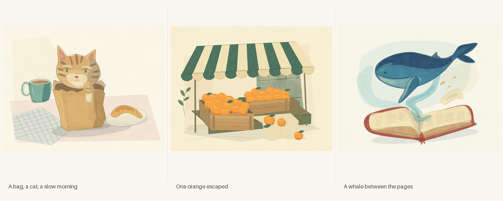
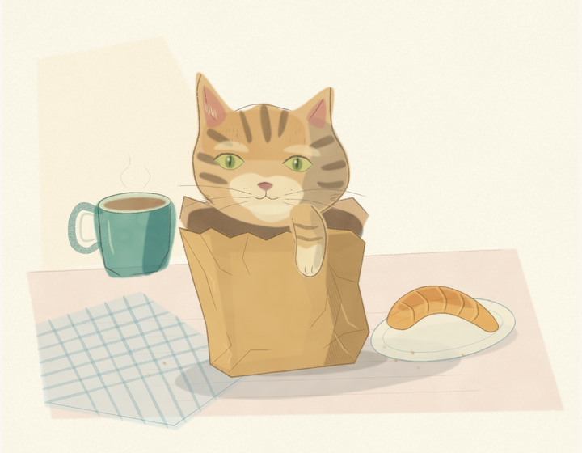
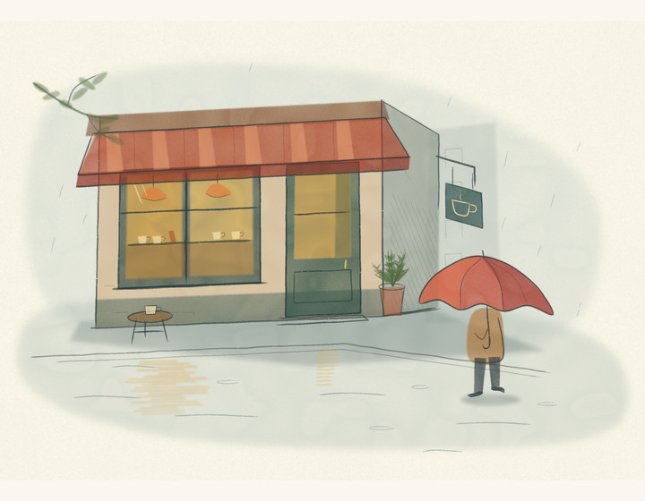
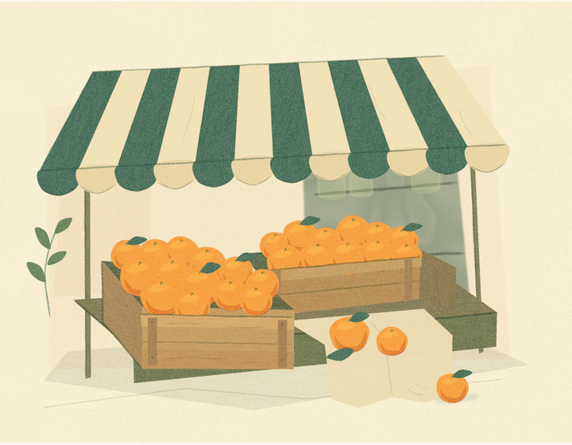
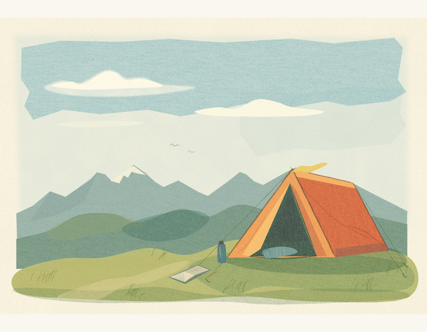
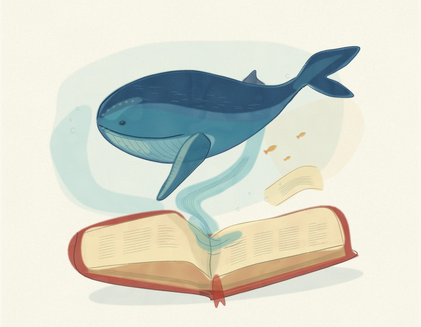
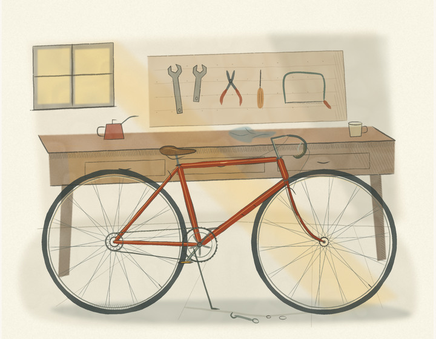
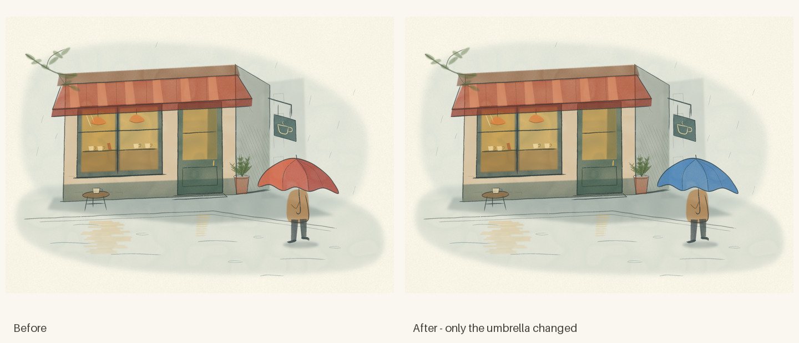
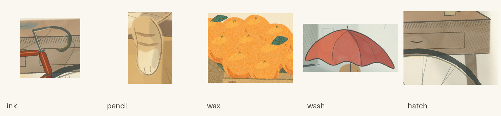

# 随手画 · Personal Sketchbook

**把一句想法，画成一页有故事的手帐。**

AI 帮你构思画面、写绘图代码；Python 负责线条、色块和纸纹。画完以后，留下的不只有一张图片，还有能继续修改的场景和图层。



> An editable sketchbook for small stories. AI plans the scene and writes the code; Python renders the ink, pencil, wax and washes. Keep the artwork, its source, and the freedom to change it.

## 翻开六页小故事

同一套工具，可以画一场雨、一阵风，也可以让一条鲸鱼从书页间游出来。下面都是实际渲染的完整作品；点图片看大图，点源文件继续改。

<!-- GALLERY:START -->
<table>
<tr>
<td width="50%"><a href="examples/gallery/breakfast-cat/artwork.png"></a><br><strong>猫把早餐纸袋当成了窝</strong><br>铅笔 · 淡彩<p>画一只把早餐纸袋当成窝的小猫，只露出脑袋和一只爪。</p><a href="examples/gallery/breakfast-cat/scene.json">场景 JSON</a> · <a href="examples/generators/breakfast_cat.py">生成脚本</a></td>
<td width="50%"><a href="examples/gallery/rainy-cafe/artwork.png"></a><br><strong>雨停前的街角咖啡店</strong><br>钢笔 · 淡彩<p>画一间雨里的街角咖啡店，暖灯亮着，门口撑着一把伞。</p><a href="examples/gallery/rainy-cafe/scene.json">场景 JSON</a> · <a href="examples/generators/rainy_cafe.py">生成脚本</a></td>
</tr>
<tr>
<td width="50%"><a href="examples/gallery/orange-market/artwork.png"></a><br><strong>周末市场的橘子摊</strong><br>蜡笔 · 铅笔<p>画一个热闹的橘子摊，一只橘子悄悄滚出了果箱。</p><a href="examples/gallery/orange-market/scene.json">场景 JSON</a> · <a href="examples/generators/orange_market.py">生成脚本</a></td>
<td width="50%"><a href="examples/gallery/windy-camp/artwork.png"></a><br><strong>风把山顶帐篷吹歪了一点</strong><br>蜡笔 · 铅笔<p>画山顶有风的露营地，帐篷偏在一旁，草和云都朝同一个方向。</p><a href="examples/gallery/windy-camp/scene.json">场景 JSON</a> · <a href="examples/generators/windy_camp.py">生成脚本</a></td>
</tr>
<tr>
<td width="50%"><a href="examples/gallery/book-whale/artwork.png"></a><br><strong>旧书里游出一条鲸鱼</strong><br>淡彩 · 钢笔<p>画一条从翻开的旧书里游出来的鲸鱼，让书页像海浪一样托住它。</p><a href="examples/gallery/book-whale/scene.json">场景 JSON</a> · <a href="examples/generators/book_whale.py">生成脚本</a></td>
<td width="50%"><a href="examples/gallery/bicycle-workshop/artwork.png"></a><br><strong>修车铺午后的最后一束光</strong><br>钢笔 · 排线<p>画修车铺里一辆旧自行车的局部，一束暖光照到车轮和木工作台。</p><a href="examples/gallery/bicycle-workshop/scene.json">场景 JSON</a> · <a href="examples/generators/bicycle_workshop.py">生成脚本</a></td>
</tr>
</table>
<!-- GALLERY:END -->

## 画完了，还能继续画

| 你想做的事 | 随手画怎么帮忙 |
| --- | --- |
| 一张画里换几支笔 | 钢笔、铅笔、蜡笔、淡彩和排线可以混用；轮廓、暗面和纸纹各有轻重。 |
| 改一个物件，不重来整幅 | 每个物件和笔触有固定 ID。固定画布、纸纹和种子后，未改对象的笔迹保持不变。 |
| 留下可以接着画的版本 | 同时保存 PNG、场景 JSON、透明对象图层和渲染记录；也保留生成场景的 Python 脚本。 |

### 比如，只给雨伞换个颜色

左边是原画，右边只改了 `umbrella` 对象里的填色。店面、人物、积水和其他物件的源数据没有改动；[对照记录](examples/edits/blue-umbrella/comparison.json) 按导出的图层文件逐一比较 SHA-256。



[原始场景](examples/gallery/rainy-cafe/scene.json) · [修改后的场景](examples/edits/blue-umbrella/scene.json) · [修改后大图](examples/edits/blue-umbrella/artwork.png)

换位置、改形状或调整轻重也可以沿着同一个 ID 继续改；如果改变遮挡关系，仍需要一起检查邻近物件。

## 五支笔，各有用处

下面是从这组作品截取的实际局部。



| 笔触 | 用在什么地方 |
| --- | --- |
| `ink` 钢笔 | 明确的结构与暗边，带轻重、断墨和收笔。 |
| `pencil` 铅笔 | 找形、轻轮廓和柔和细节，让纸纹透出来。 |
| `wax` 蜡笔 | 有方向的颗粒色块，留一点纸缝。 |
| `wash` 淡彩 | 薄色、水痕与不均匀的边缘沉淀。 |
| `hatch` 排线 | 用疏密和方向解释暗面，不把整件东西涂黑。 |

流程很简单：**描述想画的东西 → AI 安排场景与笔触 → Python 渲染图片和图层 → 看图，再改。**

手感既来自用笔，也来自具体的观察：纸袋哪儿被压皱、猫的爪子搭在哪里、风往哪个方向吹。给每条线加噪声，不能替代这些判断。

## 先画出第一张

本次发布验证环境：Python 3.11.1、Pillow 12.2.0、NumPy 2.4.4。使用隔离环境运行：

```bash
git clone https://github.com/xiaomangoyu/personal-sketchbook.git
cd personal-sketchbook
python3 -m venv .venv
.venv/bin/python -m pip install -r requirements.txt
.venv/bin/python scripts/render.py examples/gallery/breakfast-cat/scene.json --out output/first-drawing
```

打开 `output/first-drawing/artwork.png` 就能看到结果。这条命令直接重放已有场景，不需要模型或 API key。Windows 下对应的 Python 路径是 `.venv\Scripts\python.exe`；本次未验证 Windows 运行。

### 当作 Codex skill 使用

把仓库文件夹放到 `~/.codex/skills/personal-sketchbook/`。如果已有同名 skill，保留自己的修改后再更新。让 Codex 使用刚才创建的 Python 环境，然后说：

> 用 `$personal-sketchbook` 画一只趴在雨天窗台上的猫。颜色暖一点，窗外只留几笔雨，不加文字。

也可以继续说：

> 只把猫旁边的杯子改成砖红色，其他地方保留。

[SKILL.md](SKILL.md) 是给 AI 的创作与操作说明；[构图与用笔](references/art-direction.md) 讲看图时怎么判断，[绘图接口](references/render-api.md) 讲参数和数据格式。

### 用 Python 继续改

每幅画的生成脚本都支持单独输出，例如：

```bash
.venv/bin/python examples/generators/breakfast_cat.py --out output/my-cat
```

需要自己组织物件时，可以使用 [`scene_tools.py`](scripts/scene_tools.py) 的曲线、椭圆、变换和对象工具。它生成的仍然是 `version: 1` 场景，和现有渲染命令兼容。

```python
from scene_tools import Scene, ellipse

s = Scene("一片叶子", width=700, height=800, seed=42)
leaf = s.object("leaf", "叶片")
leaf.fill("color", ellipse(350, 370, 50, 125, rotate=25),
          (118, 148, 87), opacity=0.5)
leaf.line("vein", [[300, 490], [350, 370], [392, 273]],
          width=1.6, opacity=0.7)
s.save("leaf.json")
```

从脚本使用时将仓库的 `scripts` 目录加入 Python 的模块搜索路径；六份生成脚本展示了不依赖当前工作目录的写法。

## 一张画会留下什么

```text
my-drawing/
├── artwork.png       完整图片
├── scene.json        物件、几何、颜色与固定 ID
├── manifest.json     依赖版本、代码哈希、图层哈希和渲染提醒
└── layers/
    ├── _paper.png    纸面
    └── ...png        每个物件的透明图层
```

仓库保留展示原图、场景、生成脚本与记录；体积较大的对象图层可以用同一命令重新生成，不重复提交。相同代码、依赖版本和场景可复现；跨版本不承诺像素完全一致。

原来的[桌面淡彩](assets/examples/quiet-desk-preview.png)和[窗边盆栽](assets/examples/window-plant-preview.png)也保留着，适合从简单场景开始。

## 目前的边界

这是程序化绘画工具。新画面的构图和造型仍依赖 AI 写出的几何及看图修改；复杂人体、精确肖像和严谨透视需要额外检查。纸纹与水彩是视觉近似，成品仍可能带有程序插画的规整感。

当前输出静态图片和图层；没有图形编辑器、自动照片识别或连续落笔视频。作品属于 AI 辅助创作，不冒充真人手绘，也不保证“完全没有 AI 感”。

## 来源与许可

这个项目从 [盏与 North 的 pencil-case](https://github.com/Qizhan7/pencil-case) 学习程序化蜡笔与钢笔淡彩的思路，保留两份原始笔刷代码，并增加了统一场景、纸面相关笔触、局部编辑、构图指南及这组六幅原创场景。

原作者：**Sienna Qi（戚盏）与 North**。改编与维护：**[xiaomangoyu](https://github.com/xiaomangoyu)**，使用 AI 辅助开发与创作。

沿用 **[PolyForm Noncommercial 1.0.0](LICENSE)**，适用于个人爱好、学习和其他许可允许的非商业使用。复制或分享时保留许可和 Required Notice；商业用途按原许可取得授权。完整来源见 [NOTICE.md](NOTICE.md)。

## 复现与检查

```bash
.venv/bin/python -m unittest discover -s tests -v
.venv/bin/python scripts/build_showcase.py --render-scenes
.venv/bin/python scripts/check_release.py --render
```

`build_showcase.py --render-scenes` 重建内置六幅样图及其图层，再生成封面、缩略图、笔触局部和修改对照；它会覆盖内置展示输出。个人作品请单独保存。独立运行生成脚本时，重复使用同一输出目录要求显式 `--overwrite`；想保留旧版就换一个 `--out` 目录。
