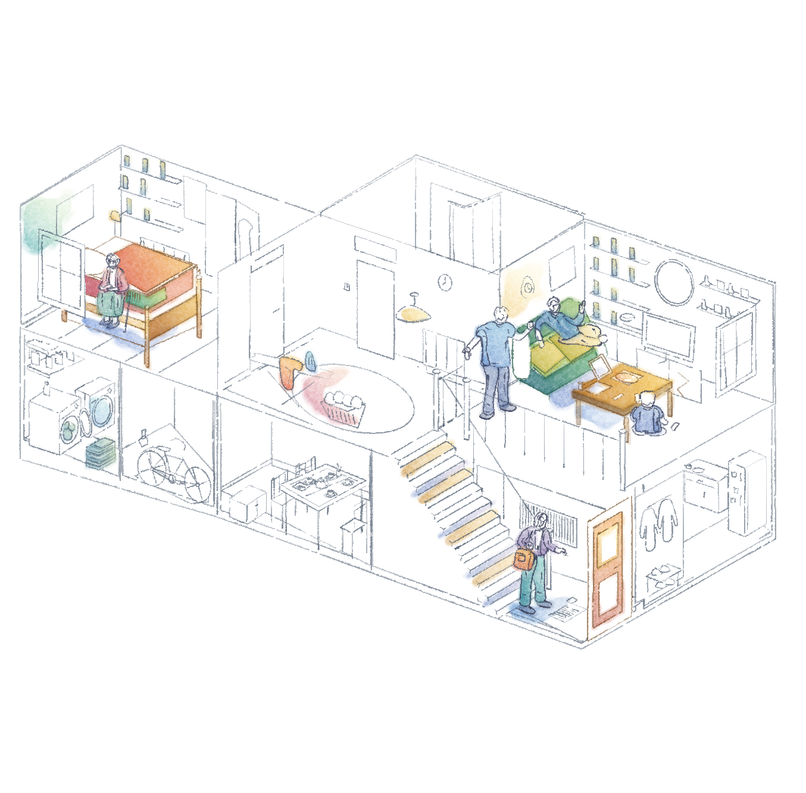

# 住宅剖面 · 鲜色与水彩晕染



依据用户提供的住宅构图，以及植物／木椅水彩参考继续试画。相较 [上一版](../house-gradient-v5/artwork.png)，增加珊瑚红与橙黄的床铺、黄绿到深绿的沙发、赭黄色木桌，以及接触处的蓝紫阴影。保持纯白纸面和选择性着色，不铺满整面墙或地板。

原版 pencil-case 笔刷生成颜料，适配层增加不均匀湿边和细小纸隙；同一形体先连续上色，再裁可见区域，避免遮挡分块造成横向色带。湿边是程序化视觉近似，不是水流模拟，也不是对参考图片套滤镜。

- [局部放大](detail.png)
- [场景 JSON](scene.json) · [生成脚本](../../generators/house_bloom_study.py)
- [渲染清单](manifest.json) · [验证记录](verification.json)
- [画法与参数](../../../references/light-watercolour.md)

安装 requirements.txt 的依赖后，从技能根目录执行：

```bash
python3 examples/generators/house_bloom_study.py --out output/house-bloom
```

AI 参与取舍和代码编写，保留可重绘场景及透明图层。这是个人非商业参考练习，未宣称参考构图原创，也不代表用户已接受此画风。上游归属及许可见根目录 NOTICE.md、LICENSE。
