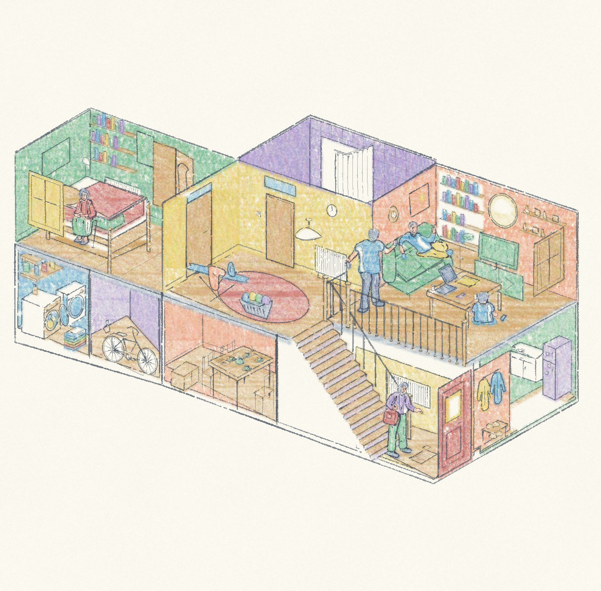

# 住宅剖面 · 粉彩蜡笔与钢笔

这版按用户新提供的粉彩蜡笔街景参考调整颜色，继续使用同一栋住宅的布局与人物。住宅构图来自用户先前提供的参考，不作为原创构图展示。



卧室用薄荷绿、走廊用淡黄、浴室用丁香紫、客厅用蜜桃色；暖木色地板串联各房间。书脊、衣物、门和床单增加小面积颜色。不是只在灰线稿上点几笔淡彩，也不在蜡笔下面铺实色。

每道蜡笔使用保留的 **pencil-case `crayon` 原笔刷**，由短笔和颗粒叠出颜色；轮廓仍使用原版 `pen_path`，局部阴影使用 `hatch`。大色面两到三次叠色，较小色面两次。纸白留在色块内部。可见色面先依据前后遮挡拆成普通多边形，场景 JSON 不嵌入参考图片或旧稿像素。

- [完整图片](artwork.png)
- [可编辑场景](scene.json)
- [渲染与图层记录](manifest.json)
- [生成脚本](../../generators/house_crayon_study.py)
- [之前的钢笔淡彩版](../house-pen-v2/artwork.png)

在项目根目录，使用已有的 `requirements.txt` 依赖：

```bash
python3 examples/generators/house_crayon_study.py --out output/house-crayon
```

也可直接重放场景：

```bash
python3 scripts/render.py examples/studies/house-crayon-v3/scene.json --out output/house-crayon-replay
```

输出使用 `version: 1`、`engine: pencil-case`，包含整图、透明物件图层和源场景。原版笔刷及前面的两幅房屋试稿保持原文件。
