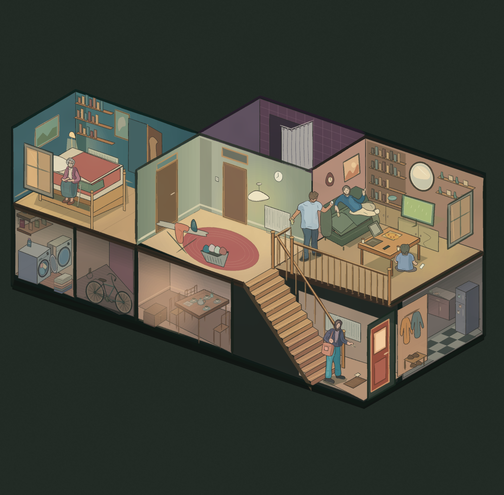

# 住宅剖面 · 参考临摹试稿

依据用户提供的住宅剖面插画绘制。构图、房间位置和人物动作来自参考，不作为原创构图展示。



这一版保留两层空间、中央楼梯、冷蓝卧室、橄榄色走廊、灰粉客厅和五个人物。书架、墙纸、厨房与餐具做了简化。色面、细墨线、排线和局部明暗全部由代码生成；没有把参考图贴进输出，也没有调用图像生成模型。

使用现有 `natural-media` 引擎。此处选用较实的叠色色面承载室内明暗，而不是前一张纸袋猫的留白淡彩。它仍是程序化临摹试稿：空间关系比前面的静物更复杂，线条节奏、人物细节和光照层次仍比参考简略。

- [完整图片](artwork.png)
- [可编辑场景](scene.json)
- [渲染记录与图层哈希](manifest.json)
- [主生成脚本](../../generators/house_cutaway_study.py)
- [几何与光色辅助](../../generators/house_geometry.py)
- [人物](../../generators/house_people.py)
- [下层家具](../../generators/house_lower_rooms.py)

在项目根目录，安装项目已有的 `requirements.txt` 后运行：

```bash
python3 examples/generators/house_cutaway_study.py --out output/house-study
```

或者直接重放场景：

```bash
python3 scripts/render.py examples/studies/house-cutaway-v1/scene.json --out output/house-replay
```

输出包括整图、场景 JSON、透明物件图层、纸层和 manifest。现有文件不会默认覆盖。
