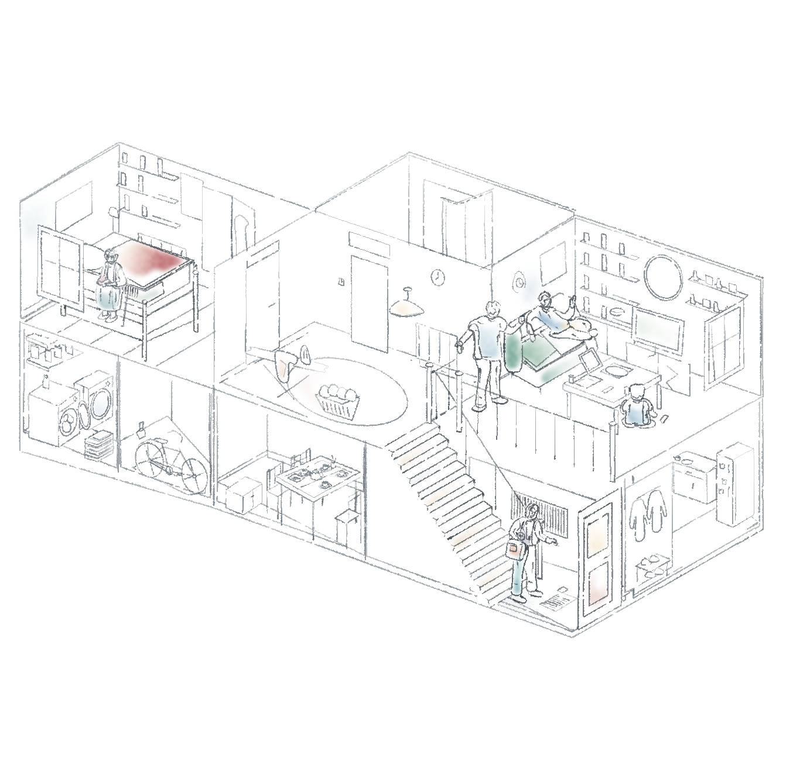

# 住宅剖面 · 简练线条与水彩渐变



依据用户提供的住宅剖面参考继续修改：[上一版](../house-watercolour-v4/artwork.png)。保留房间连接、楼梯与五位人物；减少瓷砖、书脊、栏杆和车轮辐条的重复线。纯白纸面，床铺与沙发的局部洗色渐淡，人物与接触处的墨线较重。

实际使用 pencil-case 原版 `pen_path`、`wash`、`hatch`。渐变是本项目适配层新增的透明度／色相调制，粗细变化继续由原笔刷与分层笔宽控制。AI 参与构图取舍和 Python 编写，图像由保存的场景渲染；这是个人非商业临摹练习，不宣称参考构图原创。

- [可编辑场景](scene.json)
- [生成脚本](../../generators/house_gradient_study.py)
- [渲染清单](manifest.json) 与 [验证记录](verification.json)
- [渐变用法](../../../references/light-watercolour.md)

在技能根目录执行（先安装 requirements.txt 中依赖）：

```bash
python3 examples/generators/house_gradient_study.py --out output/house-gradient
```

重画时会生成透明对象图层和白纸图层，可按场景顺序还原整图。保留旧稿，不把本次试稿当作用户已经认可的最终画风。
