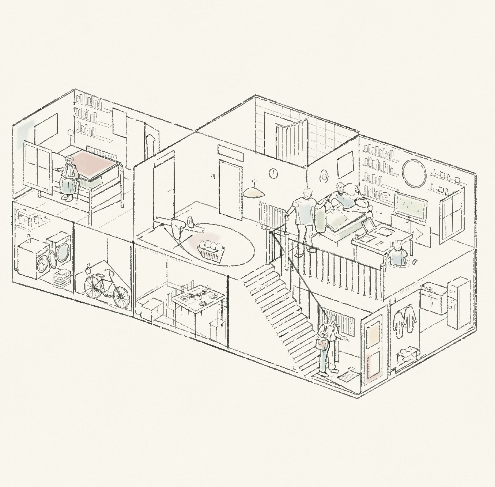

# 住宅剖面 · 原版钢笔淡彩

按用户提供的住宅剖面参考，沿用前一版的空间与人物几何，改用 **pencil-case 原版 `pen_path`、`wash`、`hatch`** 绘制。构图来自用户参考，不作为原创构图展示。



暖白纸底；主结构、家具人物、次要细节使用不同线宽与墨量。颜色只保留在床单、沙发、衣服等局部。后景轮廓在场景生成时根据前景形状裁去，所以留白处不会暴露被遮挡的家具和墙线。它不是上一张 PNG 的滤镜处理，也没有调用图像生成模型。

使用现有场景格式 `version: 1`、`engine: pencil-case`。原版笔刷文件未修改；[验证记录](verification.json) 记录了本次实际调用次数、笔刷源文件哈希与图层重组结果。数量只用于说明渲染路径，不是审美评价。

- [完整图片](artwork.png)
- [可编辑场景](scene.json)
- [图层与代码哈希](manifest.json)
- [生成脚本](../../generators/house_pen_study.py)
- [前一版色面试稿](../house-cutaway-v1/artwork.png)

在项目根目录，使用已有 `requirements.txt` 依赖：

```bash
python3 examples/generators/house_pen_study.py --out output/house-pen
```

`--ink-only` 去掉少量淡彩，保留钢笔与排线。直接重放可编辑场景：

```bash
python3 scripts/render.py examples/studies/house-pen-v2/scene.json --out output/house-pen-replay
```

仍沿用简化的房屋和人物造型；换笔刷不等于自动解决构图与造型问题。
