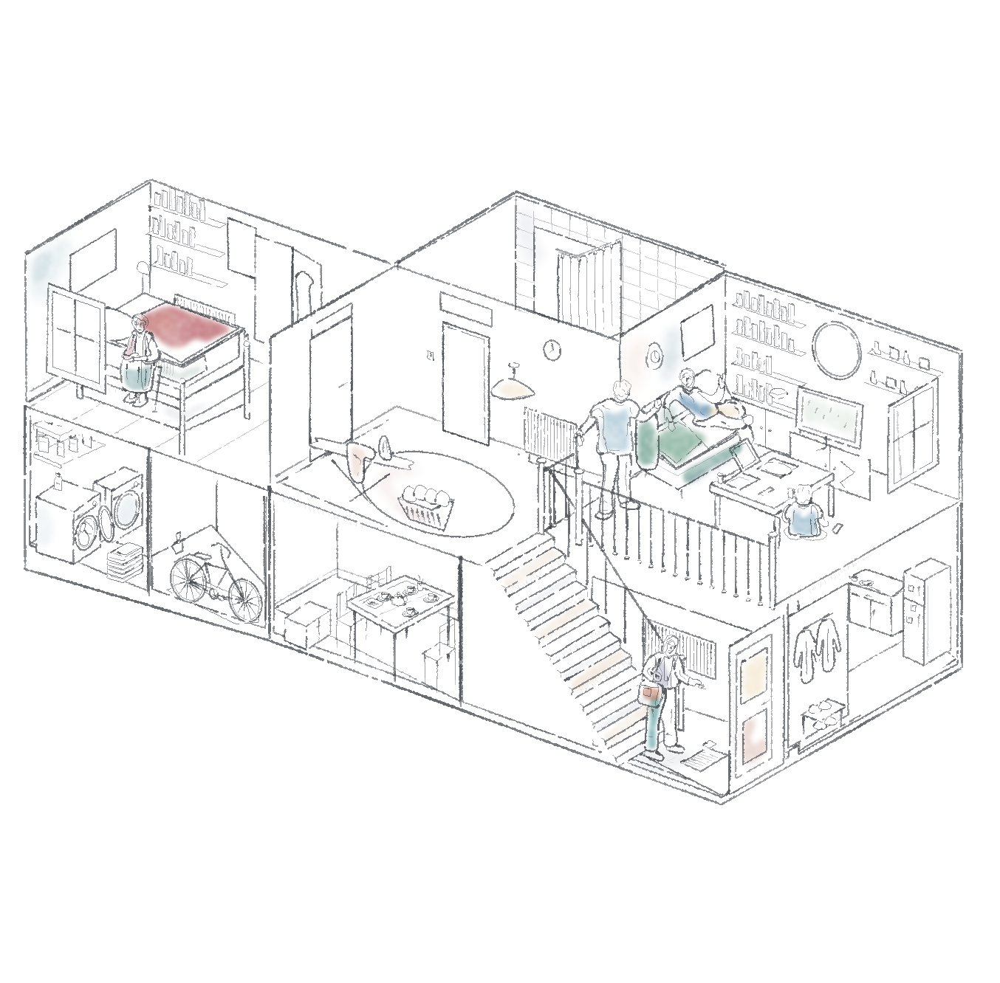

# 住宅剖面 · 白底留白水彩

按用户本轮要求：更水彩、不要每处着色、纯白背景。沿用住宅参考的空间与人物位置，重新安排局部洗色。



色彩集中在床铺、沙发、人物衣服及少数生活物件。大部分墙、地板、书架和浴帘留白。使用原版 pencil-case `wash` 的半透明叠色、水痕与柔边，轮廓使用 `pen_path`；这版没有蜡笔笔触。纸层为 `RGB(255,255,255)`、`grain: 0`，没有米色底或全局纸纹。

- [完整图片](artwork.png)
- [可编辑场景](scene.json)
- [生成脚本](../../generators/house_watercolour_study.py)
- [渲染记录](manifest.json)
- [白底和图层重组验证](verification.json)

使用项目已有依赖，在项目根目录运行：

```bash
python3 examples/generators/house_watercolour_study.py --out output/house-watercolour
```

或直接重放场景：

```bash
python3 scripts/render.py examples/studies/house-watercolour-v4/scene.json --out output/house-watercolour-replay
```

场景使用 `version: 1`、`engine: pencil-case`。来源为用户提供的住宅剖面图，属于参考临摹试稿；没有将参考图像像素粘入输出。水彩是原版笔刷的视觉近似，不是流体模拟。
