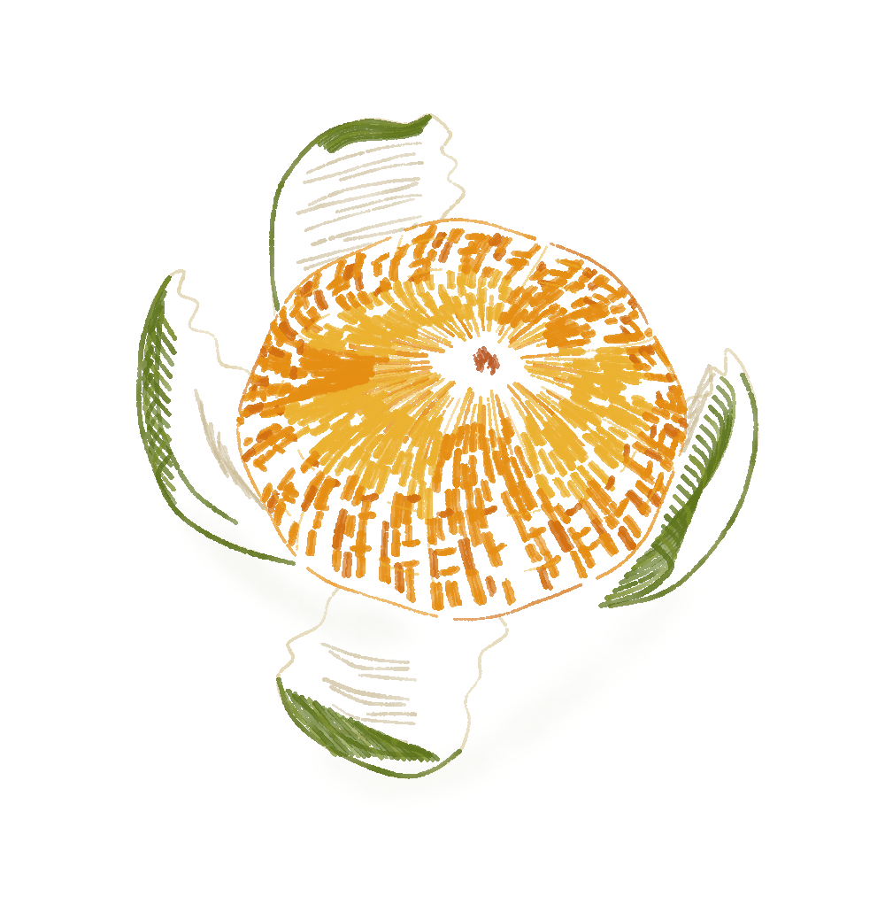

# 剥开的橘子 · 彩色线描与顺形短排线



根据用户提供的橘子参考试画：橙黄线束组成果肉，暖灰米色短线暗示白瓤，深浅绿线表现果皮翻折。橘络与果瓣间隙直接保留纸白，果皮被果肉挡住的线经过几何裁切。

实际使用 pencil-case 原版 `pen_path` 绘制有色短线，只有接触影使用少量 `wash`。没有新增渲染器类型，也没有从参考中取像素作为成图。AI 参与形状取舍和脚本编写；本图是个人非商业参考练习，不宣称参考构图原创。

- [生成脚本](../../generators/peeled_mandarin_study.py)
- [可编辑场景](scene.json)
- [渲染清单](manifest.json) · [验证记录](verification.json)
- [这种画法的 skill 指引](../../../references/coloured-linework.md)

安装 requirements.txt 中的依赖后，在技能根目录执行：

```bash
python3 examples/generators/peeled_mandarin_study.py --out output/mandarin
```

本次仍是方向试稿：果瓣线束比参考更有规律，不能由渲染和重绘验证推导审美已被接受。
